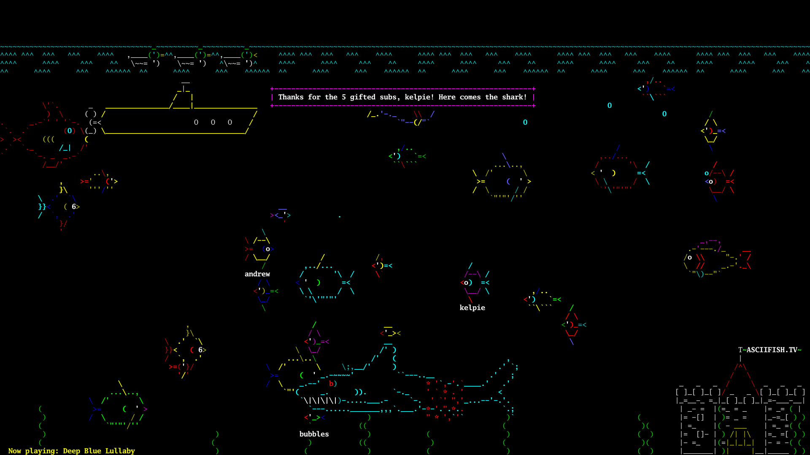

<div align="center">

# asciifish.tv

<a href="https://www.twitch.tv/asciifishtv" target="_blank"></img></a>

*The 24/7 interactive asciiquarium. Viewers buy fish, summon sharks and drop the hook.*



</div>

This repo contains **tank**, a Go port of [asciiquarium](https://github.com/ttbakiatwoam/asciiquarium)
built for streaming:

- It draws **straight to the HDMI output** of a Raspberry Pi through the Linux framebuffer. No X,
  xterm or Perl is needed, and only changed characters are repainted, so it uses little CPU.
- It can also run **headless**, either as raw video for ffmpeg or with no output at all.
- A small **HTTP API** adds named viewer fish, spawns any creature (ship, whale, monster, big fish,
  shark, fishhook, swan, ducks, dolphins, submarine, swordfish) and shows alert or ticker banners.
- It plays a folder of **MP3s** and shows **"Now playing: <title>"** now and then. Titles come
  from the files' ID3 tags.
- Global **safety limits**: rate limits, a cap on viewer fish and on-screen creatures, and
  sanitized text.

The art and behavior are taken directly from the Perl original (see [tools/extract-art](tools/extract-art)),
so the tank looks just like it always has.

## Running on the Raspberry Pi

The live setup is a Pi 4 sending 1080p over HDMI to an SDI converter and a Blackmagic Web
Presenter, which streams to Twitch.

1. Download `tank-linux-arm64` (the Pi runs 64-bit Raspberry Pi OS; `tank-linux-armv7` is for 32-bit) from the
   CI artifacts, or build it: `GOOS=linux GOARCH=arm64 go build -o tank ./cmd/tank`.
2. Install it with the systemd unit in [deploy/pi](deploy/pi):
   ```sh
   sudo install -m 755 tank /usr/local/bin/tank
   sudo mkdir -p /etc/asciifishtv
   sudo install -m 600 deploy/pi/tank.env.example /etc/asciifishtv/tank.env   # edit: token, music folder, audio device
   sudo install -m 644 deploy/pi/asciifishtv-tank.service /etc/systemd/system/
   sudo systemctl daemon-reload && sudo systemctl enable --now asciifishtv-tank
   ```
3. Raspberry Pi OS Lite is enough. On the desktop version, stop the desktop on the HDMI output
   (`sudo systemctl set-default multi-user.target`) so it doesn't draw over the tank.
   Add `hdmi_force_hotplug=1` to `/boot/firmware/config.txt` so the HDMI output stays on even if
   the converter is switched off at boot.

### Switching over from the Perl setup

Today the Pi autologins on tty1 and the last line of `~/.bashrc` runs `asciiquarium`, while a
cron job (`~/StreamMusic`) keeps mplayer looping the songs. To switch to the tank:

1. In `~/.bashrc`, delete the `asciiquarium` line (or, to keep the Perl version as a fallback,
   change it to `[ "$(tty)" = /dev/tty1 ] && asciiquarium` so SSH logins stop starting extra
   copies).
2. Remove the `* * * * * ... /home/attwoam/StreamMusic` line from `crontab -e` and stop the
   running mplayer, since the tank plays the music itself. (Otherwise cron restarts mplayer
   every minute and the music plays twice.) The daily reboot and the Web Presenter start/stop
   lines can stay: the service starts again by itself after the reboot.
3. Install and start the service as above. The unit takes over tty1 (`Conflicts=getty@tty1`).

To go back, `sudo systemctl disable --now asciifishtv-tank` and restore the `.bashrc` line.

There is also a multi-arch container image (`ghcr.io/ttbakiatwoam/asciifishtv-tank`). See the
[Dockerfile](Dockerfile) for the devices it needs.

### Other outputs

| `-output` | What it does |
|---|---|
| `fb` (default) | Draws on `/dev/fb0`, the HDMI output. |
| `term` | Draws in the current terminal (keys: `q` quit, `p` pause, `r` redraw). Handy for local testing. |
| `raw` | Writes rgb24 frames to stdout for ffmpeg. Needs no display. |
| `none` | Headless: runs the scene and API with no picture. |
| `png` | Simulates a few seconds, writes `-snapshot` and exits. |

Example of streaming without the Web Presenter (the stretch goal). Note the Pi 4's hardware
H.264 encoder tops out at 1080p:

```sh
tank -output raw -width 1920 -height 1080 -fps 20 \
  | ffmpeg -f rawvideo -pix_fmt rgb24 -s 1920x1080 -r 20 -i - \
      -c:v h264_v4l2m2m -b:v 4500k -g 40 -f flv rtmp://live.twitch.tv/app/$STREAM_KEY
```

(Mixing the music into that stream is a later step.)

## Command API

Every request except `/healthz` needs `Authorization: Bearer $TANK_TOKEN`.

```sh
# a viewer's fish: name shown under it, optional body color, stays 15 minutes by default
curl -XPOST -H "Authorization: Bearer $T" localhost:8080/v1/fish -d '{"name":"kelpie","color":"magenta"}'

# summon a creature (GET /v1/creatures lists them)
curl -XPOST -H "Authorization: Bearer $T" localhost:8080/v1/creatures/shark

# alert box (queued, one at a time) or bottom ticker line
curl -XPOST -H "Authorization: Bearer $T" localhost:8080/v1/banner -d '{"text":"Thanks for the sub, Alice!","seconds":8}'
curl -XPOST -H "Authorization: Bearer $T" localhost:8080/v1/banner -d '{"text":"Hello chat","style":"ticker"}'

# moderation
curl -H "Authorization: Bearer $T" localhost:8080/v1/fish                 # list viewer fish
curl -XDELETE -H "Authorization: Bearer $T" localhost:8080/v1/fish/3      # remove one
curl -XDELETE -H "Authorization: Bearer $T" localhost:8080/v1/fish        # remove all

curl -H "Authorization: Bearer $T" localhost:8080/v1/state                # counts and now playing
```

| Code | Meaning |
|---|---|
| 201 / 202 | Done |
| 400 | Bad input (unknown color, empty text, unknown JSON field) |
| 404 | Unknown creature or fish id |
| 409 | Tank full or too many creatures on screen. Try again later |
| 429 | Global rate limit hit. `Retry-After` says when to retry |

Global limits by default: fish 10 burst then 1 every 2s, creatures 3 burst then 1 every 20s,
banners 5 burst then 1 every 5s, at most 25 viewer fish and 3 extra creatures on screen. Per-user
quotas (free actions for subscribers, more for donors) belong in the bridge service, which comes
next.

## Roadmap

1. **Tank** (this): Go port, HDMI/headless output, command API, music titles. ✅
2. **Bridge** (runs in Kubernetes): Twitch EventSub (subs, bits, channel points, chat
   commands), Streamlabs donations, Buy Me a Coffee webhooks, and later YouTube (the stream
   also goes to YouTube through a second Web Presenter). These map to tank commands with
   per-user freemium quotas, cooldowns and mod commands.
3. **Fishing game**: a subscriber drops the hook, and whatever it catches counts toward their
   collection. Per-user catch counts by species, leaderboards, and badges shown on stream, in
   chat (`!catches`) and on a leaderboard page. The tank will send catch events to the bridge,
   which stores them. (Twitch doesn't let channels give custom chat badges to individual users.)
4. **Discord/Slack** commands for linked subscribers, using the same quotas.
5. Remember viewer fish across restarts, new creatures, and direct-to-Twitch streaming with
   audio.

## Development

```sh
go test ./...
go run ./cmd/tank -output term -listen :8080
go run ./cmd/tank -output png -demo -snapshot tank.png
```

The old Docker setup (Xvfb + xterm + ffmpeg x11grab) is kept in [legacy/](legacy).

## License

GPL-2.0-or-later, like the original asciiquarium by Kirk Baucom. The ASCII art is by Joan Stark
and the other asciiquarium contributors.
